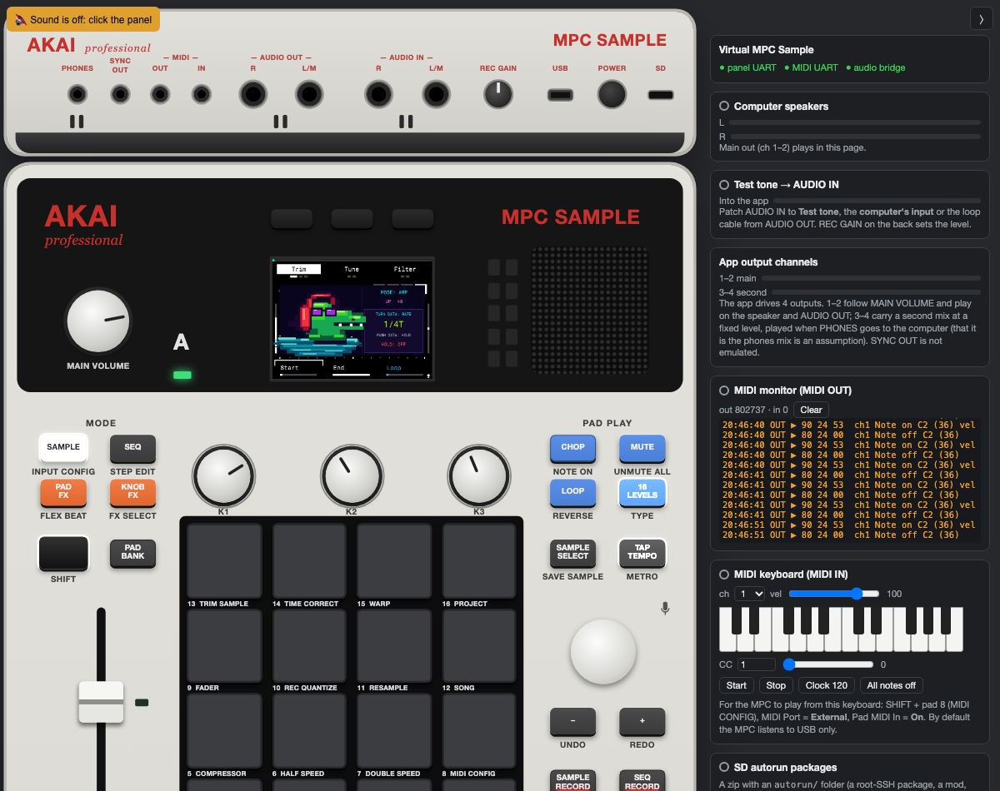
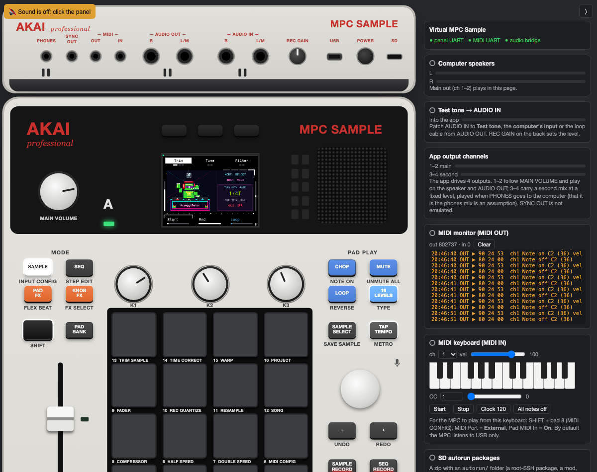
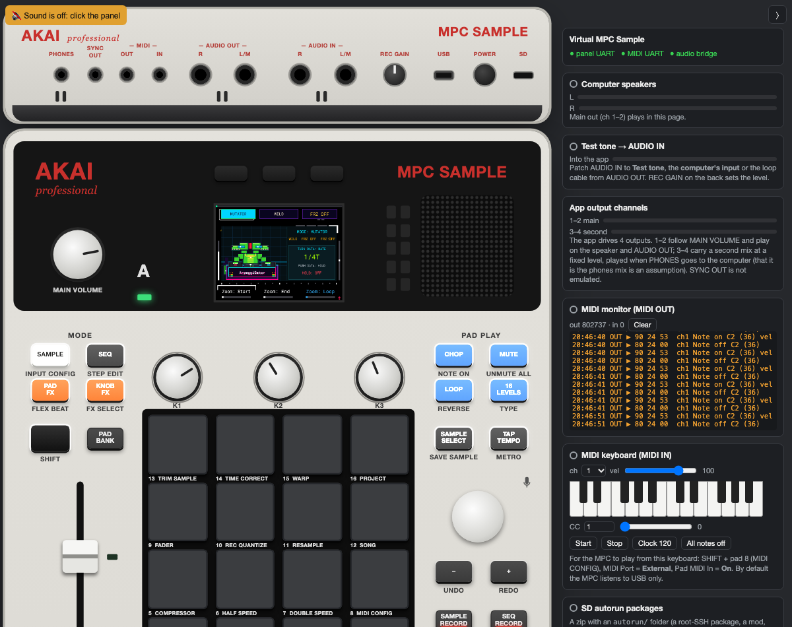
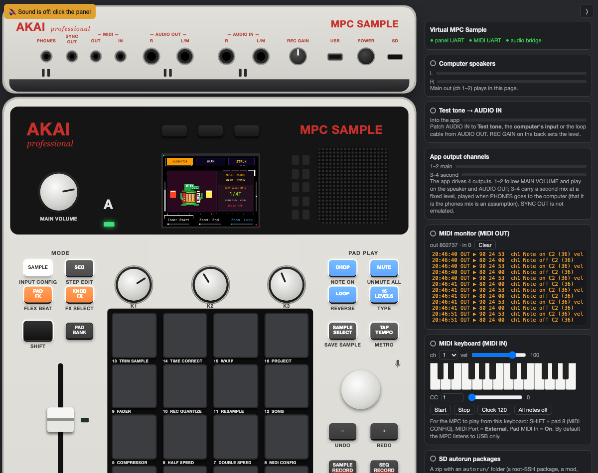
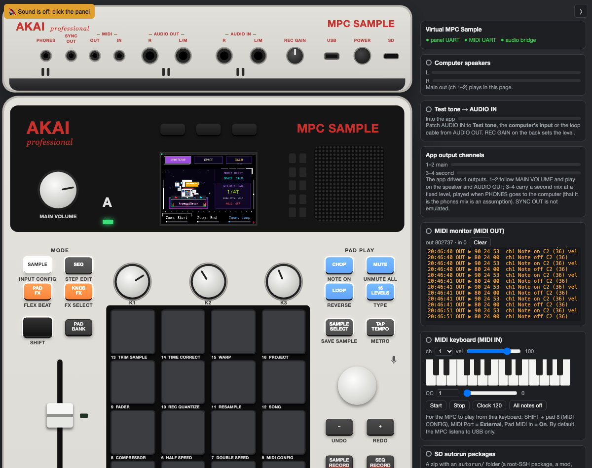

<div align="center">


# ArpeggiGator 🐊

**Five musical engines for the AKAI MPC Sample — all hidden inside 16 Levels.**

`ARP` · `MELODY` · `MUTATOR` · `ACCORDATOR` · `ORBITATOR`

**Latest published release: [v0.0.7.1](https://github.com/OSCILLUNE/ArpeggiGator/releases/tag/v0.0.7.1)** — native audio engine and the first-pad fix.

**In development: 0.0.7.2** — the chord mode is now labelled `ACCORDATOR` and the panel reads `MODE: ACCORD`. No v0.0.7.2 release has been published yet; the download links and hashes below still point to v0.0.7.1.

[⬇️ SD-card ZIP for MPC](https://github.com/OSCILLUNE/ArpeggiGator/releases/tag/v0.0.7.1) · [⬇️ Emulator `.so` for QA/DEV](https://github.com/OSCILLUNE/ArpeggiGator/releases/tag/v0.0.7.1)

[Installation](#installation) · [Interface](#interface-tree) · [Shortcuts](#shortcuts) · [Parameters](#parameters) · [Modes](#modes) · [Procedures](#procedures) · [Download](#download)

</div>

---

## ⚠️ BETA SOFTWARE — USE AT YOUR OWN RISK

> **ArpeggiGator is BETA software.** It is unofficial, experimental and provided **“AS IS”**, without warranties of any kind. You install and use it **entirely at your own risk**.
>
> Bugs or incompatibilities may cause crashes, unexpected behaviour, loss of work, damaged or corrupted project files, SD-card data loss, or other software or device problems. **Back up your projects and the entire original SD card (including any existing `autorun/` folder) before installation.**
>
> **To the maximum extent permitted by applicable law, OSCILLUNE and the project's authors and contributors accept no liability for any loss, damage, data loss, device malfunction or other consequences arising from installing or using ArpeggiGator.** Nothing in this notice excludes rights or liabilities that cannot legally be excluded.

**This mod does not replace or flash the stock MPC Sample firmware.** It adds optional functionality within **16 Levels** while preserving the normal MPC workflow. However, that does not eliminate all risks of running experimental software.

---

## What it is

ArpeggiGator is an unofficial, performance-focused mod for **Akai MPC Sample** firmware **1.3.0.12**. It adds five optional musical engines **inside the existing 16 Levels mode**. Play evolving arpeggios, melodies, chords or orbital patterns using your own samples, with hands-on controls for rate, patterns and HOLD.

**Your MPC stays your MPC.** The mod loads from the SD card at startup, copies its library to volatile `/run` and leaves the verified firmware untouched. Outside the mod's controls you can keep using the MPC Sample as usual.

- **Five engines:** classic patterns, melodic phrases, evolving mutations, expressive chords and generative ambient movement.
- **Hands-on controls:** three soft keys, the DATA encoder and your pads.
- **Original visuals:** a pixel gator and a different scene for every mode.

## Interface tree

```
MPC Sample (firmware)
└── SAMPLE screen
    └── 16 LEVELS
        └── [SHIFT held OR engine enabled] → ArpeggiGator overlay
            ├── left: animation (a different gator for each mode)
            ├── top right: MODE + parameters + RATE + HOLD
            └── bottom: B1 / B2 / B3 captions (only while SHIFT is held)
```

## Shortcuts

All shortcuts work **only in 16 Levels** (exceptions: STOP and PLAY).

| Button | Without SHIFT | With SHIFT |
|:--|:--|:--|
| **B1** (SCREEN 1) | — | **Change mode**: Off → ARP → MELODY → MUTATOR → ACCORDATOR → ORBITATOR → Off |
| **B2** (SCREEN 2) | — | **Parameter 1** — depends on the mode |
| **B3** (SCREEN 3) | — | **Parameter 2** — depends on the mode |
| **DATA** (knob) | turn = **RATE**, press = **HOLD on/off** | no action |
| **16 LEVELS** | enter/exit the view | does not exit the view |
| **PAD 1…16** | feeds notes into the engine | firmware shortcut, not a note |
| **STOP** | single press = native behaviour; **double press within ≤650 ms** = full reset | — |
| **PLAY** | the mod only reads the firmware transport | — |

The three **B** buttons are the soft keys immediately above the MPC display.

## Parameters

| Mode | B2 — parameter 1 | B3 — parameter 2 |
|:--|:--|:--|
| **ARP** | Pattern: UP, DOWN, UP/DOWN, DOWN/UP, CONVERGE, DIVERGE, RANDOM, PLAYED | Additional octaves: `+0` → `+1` → `+2` → `+3` |
| **MELODY** | Phrase length: `2BAR` → `4BAR` → `8BAR` → `16BAR` | Preset phrase: `MEL1` … `MEL9` |
| **MUTATOR** | Mutation intensity: SUBTLE → WILD → CHAOS | Freeze: `FRZ OFF` ⇄ `FRZ ON` |
| **ACCORDATOR** | Chord mood: WARM → SAD → SPACE → CINEMA | Style: STRUM → PULSE → WAVE |
| **ORBITATOR** | Atmosphere: AMBIENT → SPACE → DARK → RHYTHM | Dynamics: CALM → FLOW → WILD |

## Modes

| Mode | What it does |
|:--|:--|
| **ARP** | Accumulates held pads and plays them back in the selected pattern. HOLD toggles individual pad bits (XOR). |
| **MELODY** | Plays ready-made melodic phrases from a single root pad; a new pad takes over the voice. |
| **MUTATOR** | Evolves the buffer every phrase pass; Freeze keeps the next loops identical. |
| **ACCORDATOR** | Turns one pad into flowing chord voicings; mood sets the intervals, style sets the articulation. |
| **ORBITATOR** | Generative notes drifting across a scale; dynamics set the wandering radius. |

**Tip:** start with **ORBITATOR → AMBIENT → CALM** for evolving soundscapes, or **ACCORDATOR → WARM → WAVE** for lush harmonic movement.

| Mode | Without SHIFT | With SHIFT |
|:--|:--|:--|
| **ARP** |  |  |
| **MELODY** |  |  |
| **MUTATOR** |  |  |
| **ACCORDATOR** |  |  |
| **ORBITATOR** |  |  |

Screenshots: DEV, build `34a9ec26…`, 18 Nov 2026. The interface is unchanged in v0.0.7.1; v0.0.7.2 only renames the chord-mode label to `ACCORDATOR` / `MODE: ACCORD`.

## Procedures

1. **Enable the mod:** open **Sample** → **16 LEVELS**, hold **SHIFT**, then use **SHIFT + B1** to pick a mode and **SHIFT + B2/B3** for its parameters.
2. **HOLD and notes:** press **DATA** to toggle HOLD. In melodic/generative modes a tapped pad becomes a latch (green) and a new pad takes over the voice. In ARP, HOLD XORs pad bits.
3. **Freeze (MUTATOR):** hold SHIFT and tap **B3** to toggle `FRZ ON/OFF`; subsequent loops play identically.
4. **Swap samples while playing (test-confirmed):** set MELODY + HOLD with the sequence running, go back to the **Sample** tab — the music does **not** stop — tap pads to change one sample for the whole sequence, then return to 16 Levels.
5. **STOP:** a double press within about 650 ms clears engines, HOLD, the active sample and the LEDs.

## Installation

> **Compatibility:** designed for AKAI MPC Sample firmware **1.3.0.12**. This is an early-stage mod tested primarily in the emulator; physical-device compatibility has not yet been fully verified. A downloadable ZIP is available in the **v0.0.7.1** release, but this is still **BETA software** — back up everything before installing.

1. **Back up your entire SD card** to your computer before making any changes.
2. **MOVE / COPY / BACK UP your existing `autorun/` folder.** If the SD card already has an `autorun/` folder, move it to your computer — or copy it there, verify the backup, and then **remove the original `autorun/` folder from the SD card**. The card must have **no existing `autorun/` folder** before installing ArpeggiGator. **NEVER merge the new files into an existing `autorun/` folder.**
3. **Download `arpeggigator-v0.0.7.1.zip`** from the [v0.0.7.1 release](https://github.com/OSCILLUNE/ArpeggiGator/releases/tag/v0.0.7.1).
4. **Extract the ZIP.** You should see a new `autorun/` folder inside.
5. **Copy the NEW `autorun/` folder to the root of the SD card**, preserving all files and subfolders. The card should contain `autorun/autorun.sh` — not a ZIP file placed on the card.
6. **Safely eject the SD card**, power off the MPC Sample, insert the card and power it on.
7. **Open Sample → 16 Levels** and use the controls above.

**Already using another mod?** ArpeggiGator's `autorun/` folder **replaces** the previous one on that card; it is **not** merged with it. Keep the old `autorun/` backup safe so you can restore it later. Running multiple autorun mods together is not supported or verified.

**Uninstall / restore:** power off the MPC, remove the ArpeggiGator card or restore your original backed-up `autorun/` folder, then restart.

## Preview

<div align="center">

**Running in the MPC Sample emulator**


</div>

## Download

Documentation version **0.0.7.2 (in progress)** — one codebase, two delivery profiles. The published artifacts below are still from the [v0.0.7.1 release](https://github.com/OSCILLUNE/ArpeggiGator/releases/tag/v0.0.7.1); they will be replaced with the 0.0.7.2 build and fresh hashes once that release is published.

| Artifact | Purpose | SHA-256 |
|:--|:--|:--|
| `arpeggigator-v0.0.7.1.zip` | SD card → physical MPC Sample 1.3.0.12. Unzip and copy `autorun/` to the card. | `66846aaaf73b06b218ebc63c9ecea8606e97c14e7f9aecd677bc1aea8f4678e9` |
| `arpeggigator-v0.0.7.1-lab.so` | Emulator / QA-DEV via `python3 lab.py preload …`. **This is not an SD-card package.** | `66e4c6cbd5125c15af83da06b29d7f6cc94e157f1cdfaa0fe847f13899ab6df8` |

The `arpeggigator-v0.0.7.1.zip.sha256` sidecar is in the same release. Verify before inserting the card:

```
shasum -a 256 -c arpeggigator-v0.0.7.1.zip.sha256
```

- **Verified environment:** firmware-targeted aarch64 MPC Sample emulator. **Physical hardware testing is still required.**
- **Independent project:** not affiliated with, endorsed by or supported by AKAI Professional.

## Development notes

Interested in the implementation? See the [release record](docs/RELEASE-0.0.7.1.md), [implementation notes](docs/IMPLEMENTATION.md), [development setup](docs/DEVELOPMENT.md) and the [roadmap](docs/ROADMAP.md).

Built by **OSCILLUNE** · [Changelog](CHANGELOG.md) · [License](LICENSE)
