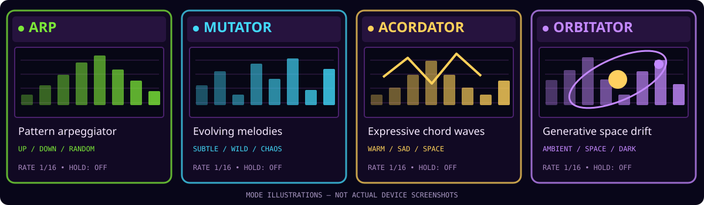
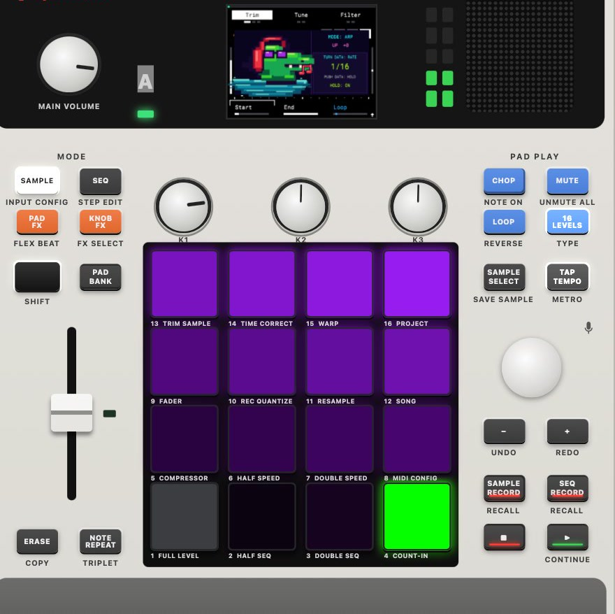

**Five musical engines for the AKAI MPC Sample — all hidden inside 16 Levels.**

`ARP` · `MELODY` · `MUTATOR` · `ACORDATOR` · `ORBITATOR`

**The download link is ready, but a GitHub Release with an installable ZIP has not been published yet.**

[Installation](#installation) · [How to use](#how-to-use) · [Modes](#the-five-modes) · [Preview](#preview) · [Development notes](#development-notes)

---

## ⚠️ BETA SOFTWARE — USE AT YOUR OWN RISK

> **ArpeggiGator is BETA software.** It is unofficial, experimental and provided **“AS IS”**, without warranties of any kind. You install and use it **entirely at your own risk**.
>
> Bugs or incompatibilities may cause crashes, unexpected behaviour, loss of work, damaged or corrupted project files, SD-card data loss, or other software or device problems. **Back up your projects and the entire original SD card (including any existing `autorun/` folder) before installation.**
>
> **To the maximum extent permitted by applicable law, OSCILLUNE and the project's authors and contributors accept no liability for any loss, damage, data loss, device malfunction or other consequences arising from installing or using ArpeggiGator.** Nothing in this notice excludes rights or liabilities that cannot legally be excluded.

**This mod does not replace or flash the stock MPC Sample firmware.** It adds optional functionality within **16 Levels** while preserving the normal MPC workflow. However, that does not eliminate all risks of running experimental software.

---

## Make your pads come alive

ArpeggiGator is an unofficial, performance-focused mod for **AKAI MPC Sample**. It adds five optional musical engines **inside the existing 16 Levels mode**. Play evolving arpeggios, melodies, chords or orbital patterns using your own samples, with hands-on controls for rate, patterns and HOLD.

**Your MPC stays your MPC.** ArpeggiGator does **not flash, replace or rewrite the original MPC Sample firmware**. It loads from the SD card at startup and adds functionality in **16 Levels**, while keeping the original screens and familiar workflow available. Outside the mod's controls, you can continue using the MPC Sample as usual.

- **Five engines:** classic patterns, melodic phrases, evolving mutations, expressive chords and generative ambient movement.
- **Hands-on controls:** three soft keys, the DATA encoder and your pads.
- **No firmware replacement:** SD-card `autorun/` loading, with the original MPC Sample software and everyday workflow preserved.
- **Original visuals:** a pixel gator and mode-specific scenes.

## Installation

> **Compatibility:** designed for AKAI MPC Sample firmware **1.3.0.12**. This is an early-stage mod tested primarily in the emulator. Physical-device compatibility has not yet been fully verified. Do not install until an official downloadable ZIP is published.

1. **Back up your entire SD card** to your computer before making any changes.
2. **MOVE / COPY / BACK UP your existing `autorun/` folder.** If the SD card already has an `autorun/` folder, move it to your computer — or copy it there, verify the backup, and then **remove the original `autorun/` folder from the SD card**. The SD card must have **no existing `autorun/` folder** before you install ArpeggiGator. **NEVER merge the new files into an existing `autorun/` folder.**
3. **Download the latest release ZIP** using the purple button above, once a release is available.
4. **Extract the ZIP.** You should see a new `autorun/` folder inside.
5. **Copy the NEW `autorun/` folder to the root of the SD card**, preserving all files and subfolders. The card should contain `autorun/autorun.sh` — not a ZIP file placed on the card.
6. **Safely eject the SD card**, power off the MPC Sample, insert the card and power it on.
7. **Open Sample → 16 Levels** and use the controls below.

**Already using another mod?** ArpeggiGator's `autorun/` folder **replaces** the previous one on that card; it does **not** get added to or merged with it. Keep the old `autorun/` backup safe so you can restore it later. Running multiple autorun mods together is not supported or verified.

**Uninstall / restore:** power off the MPC, remove the ArpeggiGator card or restore your original backed-up `autorun/` folder, then restart.

## How to use

1. Open the **Sample** page and enable **16 Levels**.
2. Hold **SHIFT** and press the soft key **B1** (first key above the screen) to select a mode.
3. Use **SHIFT + B2** and **SHIFT + B3** to change that mode’s options.
4. **Turn DATA** to choose the rhythmic rate; **press DATA** to toggle `HOLD: ON / OFF`.
5. Play your pads. In **ARP**, hold multiple pads; the other generative engines use a **single root pad**.
6. **Double-tap STOP** (within approximately 800 ms) to silence the engine and clear active pad states.

### Quick control reference

| Control | Action |
|:--|:--|
| `SHIFT + B1` | Cycle `OFF → ARP → MELODY → MUTATOR → ACORDATOR → ORBITATOR → OFF` |
| `SHIFT + B2` | Change the first parameter for the current mode |
| `SHIFT + B3` | Change the second parameter (or toggle FREEZE in MUTATOR) |
| `Turn DATA` | Set rate / rhythmic subdivision |
| `Press DATA` | Toggle HOLD (latch playback after releasing a pad) |
| `Double STOP` | Panic stop: silence notes and reset pad states |

The three **B** buttons are the soft keys immediately above the MPC display. ArpeggiGator shortcuts are scoped to **16 Levels**.

## The five modes

| Mode | What it does | `SHIFT + B2` | `SHIFT + B3` |
|:--|:--|:--|:--|
| **ARP** | Plays notes from held pads in patterns | Pattern: UP, DOWN, UP/DOWN, DOWN/UP, CONVERGE, DIVERGE, RANDOM, PLAYED | Additional octaves: `+0` … `+3` |
| **MELODY** | Plays melodic phrases from one root pad | Phrase length | Melody variant (`MEL1` … `MEL9`) |
| **MUTATOR** | Evolves a melody as it repeats | Intensity: SUBTLE, WILD, CHAOS | Toggle FREEZE |
| **ACORDATOR** | Turns one pad into flowing chord voicings | Mood: WARM, SAD, SPACE, CINEMA | Style: STRUM, PULSE, WAVE |
| **ORBITATOR** | Creates drifting, scale-based generative notes | Atmosphere: AMBIENT, SPACE, DARK, RHYTHM | Dynamics: CALM, FLOW, WILD |

**Tip:** Start with **ORBITATOR → AMBIENT → CALM** for evolving soundscapes, or **ACORDATOR → WARM → WAVE** for lush harmonic movement.

## Preview

**Running in the MPC Sample emulator**

**ARP, MUTATOR, ACORDATOR and ORBITATOR:** the artwork above shows illustrative mode cards. Actual per-mode emulator screenshots are not yet stored in this repository and will replace the illustrations when available.

## Download and compatibility status

- **Latest stable / verified version:** **`v0.0.5.1`** — see the [release verification report](docs/RELEASE-REPORT-v0.0.5-1.md).
- **Development version:** `0.0.5.2` — a bug fix is in progress; **not recommended for download or installation**.
- **Downloadable GitHub Release:** not published yet. The main download button points to the future latest release.
- **Verified environment:** firmware-targeted aarch64 MPC Sample emulator. **Physical hardware testing is still required.**
- **Independent project:** not affiliated with, endorsed by or supported by AKAI Professional.

## Development notes

Interested in the implementation? See [release verification](docs/RELEASE-REPORT-v0.0.5-1.md), [implementation notes](docs/IMPLEMENTATION.md), [development setup](docs/DEVELOPMENT.md) and the [roadmap](docs/ROADMAP.md).

Built by **OSCILLUNE** · [Changelog](CHANGELOG.md) · [License](LICENSE)
