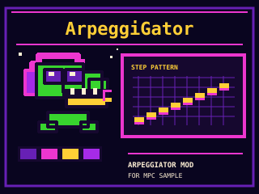

# ArpeggiGator 🐊

**Standalone arpeggiator mod for the AKAI MPC Sample.**

**Version 0.0.2.2 — experimental emulator audio.**

ArpeggiGator targets stock MPC Sample firmware **1.3.0.12**. It is independent of SampQOL.

## Controls

In 16 Levels mode:

| Shortcut | Action |
|---|---|
| SHIFT + B1 | ARP on/off |
| SHIFT + B2 | Cycle pattern |
| SHIFT + B3 | Cycle additional-note setting (+0, +1, +2, +3; default +0) |

B1, B2 and B3 are the three soft keys above the display. Their custom labels appear only while SHIFT is held in 16 Levels. The ordinary Sample and 16 Levels screens remain visible by default.

## Patterns

UP · DOWN · UP/DOWN · DOWN/UP · CONVERGE · DIVERGE · RANDOM · PLAYED

The pure Rust engine tracks the held-pad set and strike velocities. Unit tests cover all main pattern directions and edge cases.

## Current development status

The opt-in emulator audio build generates arpeggios, including HOLD, rate and pattern selection, and up to three additional octave notes. The standard hardware package does not enable experimental audio.

Committed now:
- SDK integration pinned to a specific revision.
- SHIFT+B1/B2/B3 controls scoped to 16 Levels, with temporary custom softkey captions.
- An on-demand pixel gator overlay when ARP is enabled.
- Eight-pattern engine and host tests.
- Host-testable timing engine for 1/4, 1/8, 1/8T, 1/16, 1/16T and 1/32 rates, with gate control and paired note events.
- Read-only BPM discovery from the active working project file.
- Experimental native audio retriggering, HOLD and additional octave notes in the opt-in emulator build.
- Firmware-guarded build/package script and GitHub Actions CI.

Still pending:
- Connecting the chewing animation to actual arpeggiated note events; the current motion is a visual preview.
- Validating the additional-note pitch limits and recording behaviour on the emulator and hardware.
- Aligning the arpeggiator clock and recording behaviour with the transport and stock NOTE REPEAT.
- Validation that the temporary project file updates immediately when unsaved sequence or global tempo changes are made.
- Hardware verification of the clock and note lifecycle.

The emulator audio build is experimental and is not a hardware audio release.

## Build

The SDK requires Rust 1.97+, Zig, LLVM binutils, Python 3 and zip. Run:

    sh scripts/build.sh

This produces `build/arpeggigator.zip`, a firmware-guarded SD autorun package. The MPC
loads it on each boot while that card remains inserted. The library itself is copied to
`/run`, so it does not modify the verified firmware.

When the virtual MPC is running with the matching ArpeggiGator autorun card,
the build also updates its module on that card. If the card is unavailable,
the build prints a warning; run `python3 scripts/sync-emulator-autorun.py`
after starting the emulator to update it. Restart the MPC to load the update.

## Technical notes

- docs/RESEARCH.md — verified API contracts
- docs/IMPLEMENTATION.md — runtime design
- docs/ROADMAP.md — milestones

## License

The project license is still to be selected.
