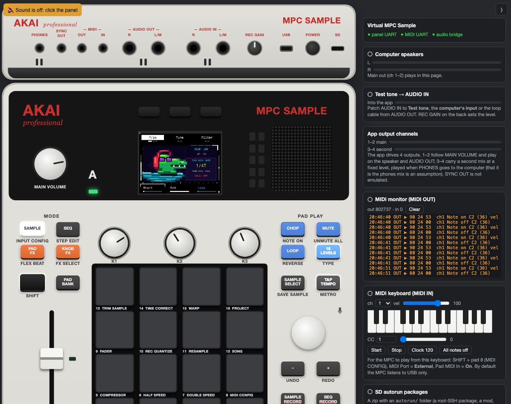
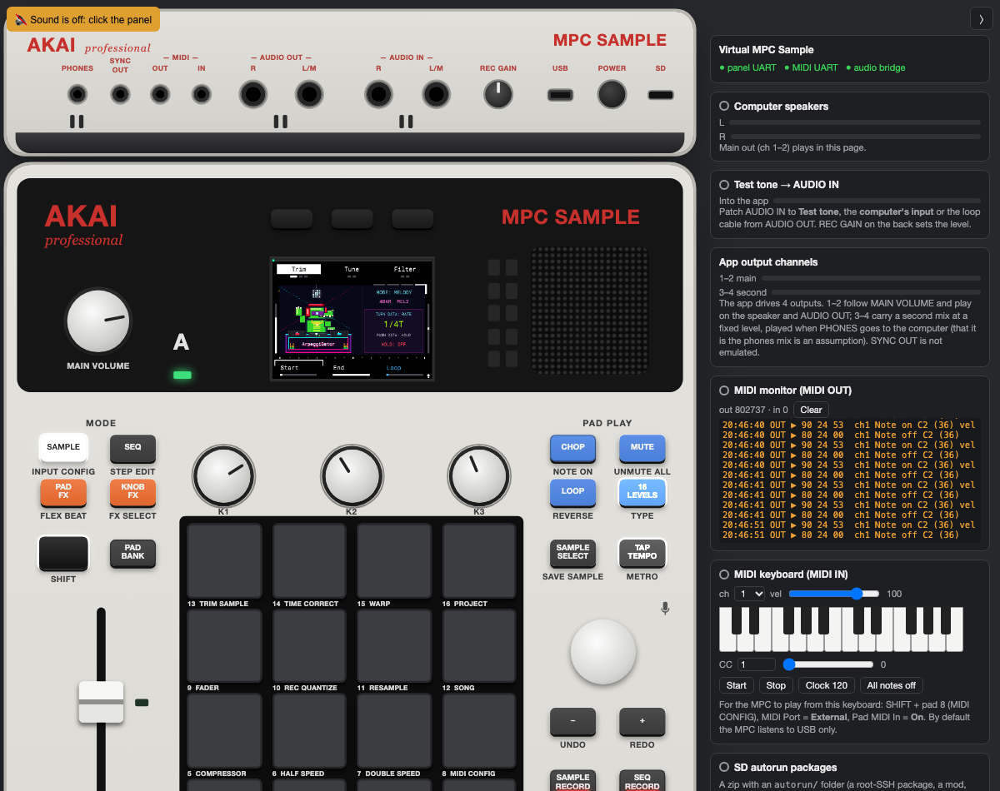
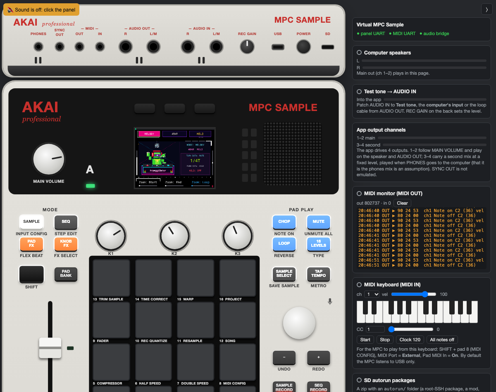
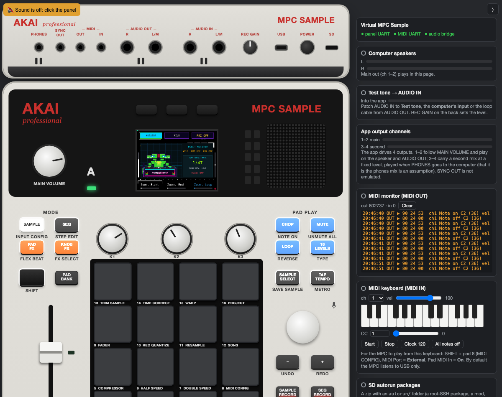
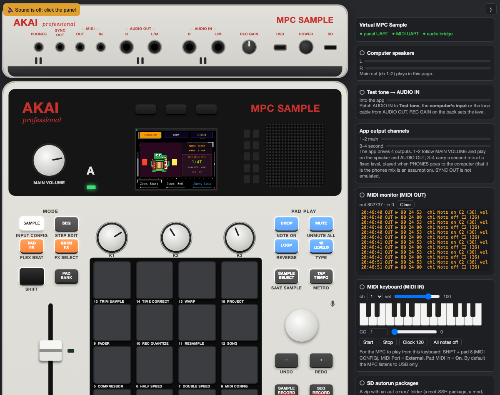
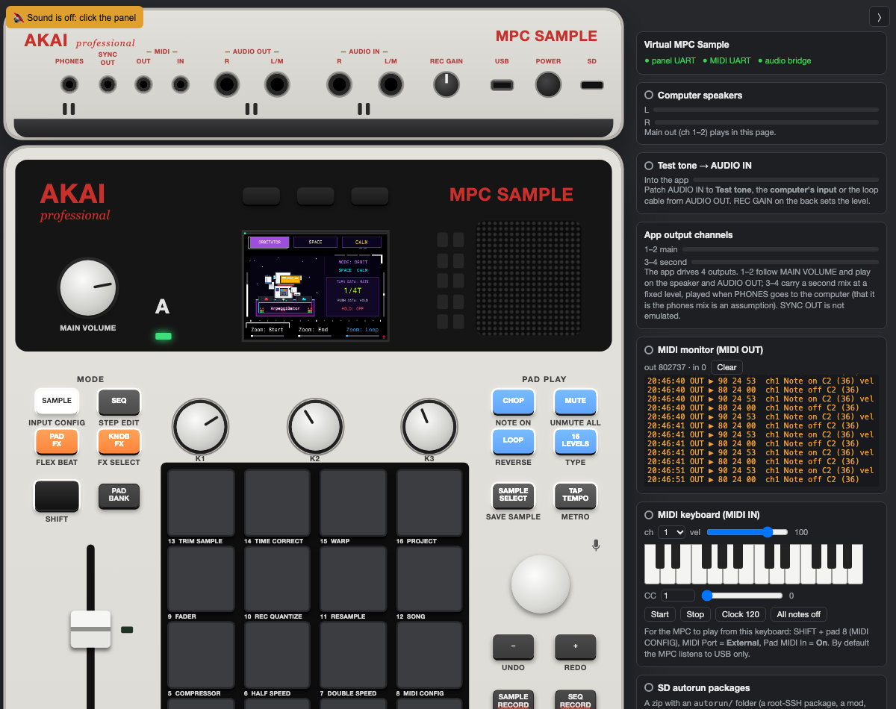

# ArpeggiGator — Users Manual / GUI v0.0.7.1

**Wersja opisana:** `v0.0.7.1` (release; interfejs bez zmian względem `v0.0.6.0`)
**Baza UI:** tag `v0.0.6.0`, commit `b912eed1028c9b9c54a166b36433cd349e782be0`
**Build na screenach:** `34a9ec26949b98c7a3ec83562aea94af9ba7d9f35771687db0d3e929841a5b7b`
**Źródło faktów:** kod tagu `v0.0.6.0` + release `v0.0.7.1` (natywny silnik audio i fix pierwszego padu).
**Przeznaczenie:** instrukcja dla użytkownika. Procedury testowe dla AI pozostają wyłącznie w wewnętrznej dokumentacji QA i nie są częścią tej publicznej wersji.

---

## 1. Czym jest ArpeggiGator

Nakładka (mod) na firmware **Akai MPC Sample 1.3.0.12**. Dodaje pięć silników muzycznych widocznych na ekranie urządzenia w trybie **Sample + 16 Levels**. Nie zmienia natywnego ekranu na co dzień — Sample i 16 Levels wyglądają normalnie, dopóki nie przytrzymasz SHIFT lub nie włączysz silnika.

Silnie uproszczony model:

```
MPC Sample (firmware)
└── ekran SAMPLE
    └── 16 LEVELS
        └── [SHIFT trzymany LUB silnik włączony] → NAKŁADKA ArpeggiGator
            ├── lewo: animacja (inny "aligator" dla każdego trybu)
            ├── prawa góra: MODE + parametry + RATE + HOLD
            └── dole: podpisy B1 / B2 / B3 (tylko pod SHIFT-em)
```

---

## 2. Drzewko opcji — skróty klawiatury

Wszystkie poniższe działają **tylko w 16 Levels** (wyjątek: STOP i PLAY).

| Przycisk | Bez SHIFT | Z SHIFT |
|---|---|---|
| **B1** (SCREEN 1) | — | **Zmiana trybu**: Off → ARP → MELODY → MUTATOR → ACORDATOR → ORBITATOR → Off |
| **B2** (SCREEN 2) | — | **Parametr 1** — zależny od trybu (patrz tabela niżej) |
| **B3** (SCREEN 3) | — | **Parametr 2** — zależny od trybu |
| **DATA** (pokrętło) | obrót = **RATE**, wciśnięcie = **HOLD on/off** | brak działania |
| **16 LEVELS** | wejście/wyjście z widoku (tylko na ekranie Sample) | nie wychodzi z widoku |
| **PAD 1…16** | wprowadza nuty do silnika | skrót sistemowy firmware'u, nie nuta |
| **STOP** | pojedyncze = natywne; **podwójne w ≤650 ms** = pełny reset ArpeggiGatora | — |
| **PLAY** | mod tylko czyta stan transportu firmware'u; nie ma własnej obsługi PLAY | — |

**Kluczowa zasada dla testów:** SHIFT i B\* wysyłaj jako **osobne** zdarzenia (press/release), nigdy w jednej paczce — inaczej firmware może zgubić stan SHIFT-a i krok będzie nieważny. Zrzut ekranu rób **w trakcie trzymania**, nie po puszczeniu.

---

## 3. Tabela parametrów B2 / B3 dla każdego trybu

| Tryb | B2 — parametr 1 | B3 — parametr 2 |
|---|---|---|
| **ARP** | Wzorzec: `UP → DOWN → UP/DOWN → DOWN/UP → CONVERGE → DIVERGE → RANDOM → PLAYED` | Dodatkowe oktawy: `+0 → +1 → +2 → +3` (kopie najniższego padu) |
| **MELODY** | Długość frazy: `2BAR → 4BAR → 8BAR → 16BAR` (32/64/128/256 kroków) | Gotowa fraza: `MEL1 … MEL9` |
| **MUTATOR** | Intensywność mutacji: `SUBTLE → WILD → CHAOS` | **Freeze**: `FRZ OFF ⇄ FRZ ON` |
| **ACCORDATOR** | Nastrój akordu: `WARM → SAD → SPACE → CINEMA` | Styl: `STRUM → PULSE → WAVE` |
| **ORBITATOR** | Atmosfera: `AMBIENT → SPACE → DARK → RHYTHM` | Dynamika: `CALM → FLOW → WILD` (promień 7/14/24 półtonów) |

Prawy panel pokazuje dokładnie: `MODE: ARP | MELODY | MUTATOR | ACORD | ORBIT` oraz linię parametrów i `RATE`. W MUTATORZE v0.0.6.0 `FRZ` pojawia się **dwukrotnie** (w podpisie B3 i w panelu) — to znany, potwierdzony testami fakt, nie błąd do naprawiania w tej wersji.

---

## 4. Tryby — opis i screeny

Screeny z DEV, build `34a9ec26…`, wymiar `1200x950`. Plik `_plain` = widok bez SHIFT, `_shift` = w momencie trzymania SHIFT (widać podpisy B1–B3).

### 4.1 ARP — zielony "krokodyl" na tle.wzorce
`MODE: ARP`, wzorzec i `+N`. Akumuluje wciśnięte pady i odtwarza je w wybranym porządku. HOLD przełącza pojedyncze bity padów (XOR).




### 4.2 MELODY — klub, różowa scena
`MODE: MELODY`, `2BAR…16BAR`, `MEL1…MEL9`. Gotowe frazy melodyczne; nowy pad „kradnie" głos (monofonicznie).




### 4.3 MUTATOR — laboratorium, cyjan
`MODE: MUTATOR`, intensywność i `FRZ ON/OFF`. Mutuje bufor co pełny przebieg frazy. **Freeze** zatrzymuje dalszą mutację — kolejne pętle grają identycznie. Stan freeze jest widoczny w podpisie B3 i w panelu moda.




### 4.4 ACCORDATOR — ciepła scena akordów, bursztyn
`MODE: ACORD`, nastrój i styl. Interwały akordu zależą od nastroju; `STRUM/PULSE/WAVE` zmienia sposób artykulacji.




### 4.5 ORBITATOR — kosmos, fiolet
`MODE: ORBIT`, atmosfera i dynamika. Melodia wędruje po skali; `CALM/FLOW/WILD` to promień wędrówki.




---

## 5. Obsługa — procedury krok po kroku

### 5.1 Włączenie moda
1. Wejdź na ekran **Sample**.
2. Naciśnij **16 LEVELS**.
3. Przytrzymaj **SHIFT** — pojawiają się podpisy softkeyów i nakładka.
4. **SHIFT + B1** → wybierz tryb. **SHIFT + B2/B3** → parametry.

### 5.2 HOLD i nuty
- Wciśnij **DATA** (HOLD: ON).
- W trybach melodycznych/generatywnych kliknij pad — staje się zatrzaskiem (zielony). Nowy pad przejmuje głos.
- W ARP HOLD XOR-uje bity: kliknięcie tego samego pada wyłącza go.
- Kolejne wciśnięcie DATA czyści zatrzaski i wyłącza HOLD.

### 5.3 Freeze (tylko MUTATOR)
Ustaw tryb MUTATOR, przytrzymaj SHIFT i naciśnij B3 (`FRZ ON`). Sekwencja przestaje się mutować. Ponowny SHIFT+B3 → `FRZ OFF`.

### 5.4 Podmiana sampli w trakcie gry (potwierdzone testami)
1. Ustaw MELODY, włącz HOLD i sekwencję.
2. Wyjdź z 16 Levels na ekran **Sample**. Muzyka **nie staje** (`BACKGROUND_PLAYBACK_ACTIVE`).
3. Klikaj pady na ekranie sampla — zmieniasz **jeden sampel dla całej sekwencji** (dla wszystkich nut).
4. Wróć do 16 Levels — sekwencja gra dalej z nowym samplem.

Dyski niezmienione: już brzmiący głos nie jest przestrajany; zmiana dotyczy kolejnych nut.

### 5.5 STOP
- Pojedynczy STOP = zachowanie natywne.
- **Podwójny STOP w ciągu 650 ms** = pełny reset: Off, wyczyszczenie silników, HOLD, aktywnego sampla i podświetleń LED.

---

## 6. Pobierz

Wersja **0.0.7.1** — jeden kod, dwa profile dostarczenia. Oba artefakty są pod tagiem
[v0.0.7.1](https://github.com/OSCILLUNE/ArpeggiGator/releases/tag/v0.0.7.1).

| Artefakt | Przeznaczenie | SHA-256 |
|---|---|---|
| `arpeggigator-v0.0.7.1.zip` | Karta SD → fizyczna MPC Sample 1.3.0.12. Po rozpakowaniu skopiuj katalog `autorun/` na kartę. [Pobierz z release'u](https://github.com/OSCILLUNE/ArpeggiGator/releases/tag/v0.0.7.1). | `66846aaaf73b06b218ebc63c9ecea8606e97c14e7f9aecd677bc1aea8f4678e9` |
| `arpeggigator-v0.0.7.1-lab.so` | Emulator / QA-DEV: `python3 lab.py preload …`. **To nie jest paczka na kartę SD.** [Pobierz z release'u](https://github.com/OSCILLUNE/ArpeggiGator/releases/tag/v0.0.7.1). | `66e4c6cbd5125c15af83da06b29d7f6cc94e157f1cdfaa0fe847f13899ab6df8` |

Sidecar `arpeggigator-v0.0.7.1.zip.sha256` jest w tym samym release. Przed włożeniem karty zweryfikuj paczkę:

```
shasum -a 256 -c arpeggigator-v0.0.7.1.zip.sha256
```

---

Opis UI i screeny pochodzą z v0.0.6.0 (interfejs bez zmian w 7.1). Screeny: DEV, build `34a9ec26…`, 18.11.2026. Manual przygotowany przez Heńka.
