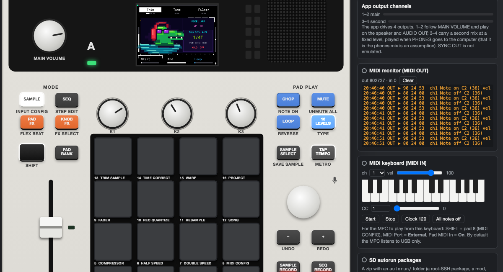
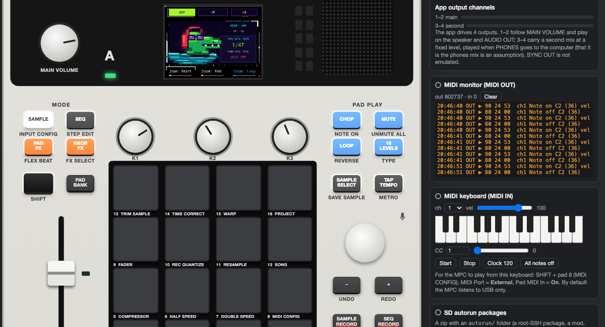
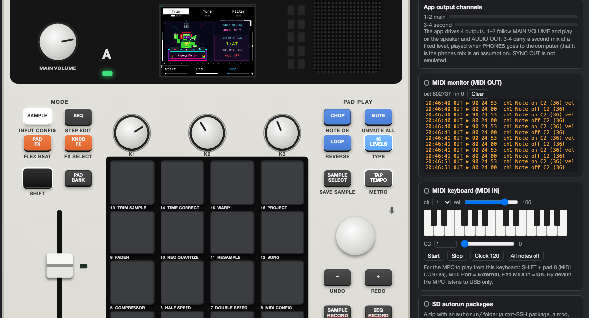
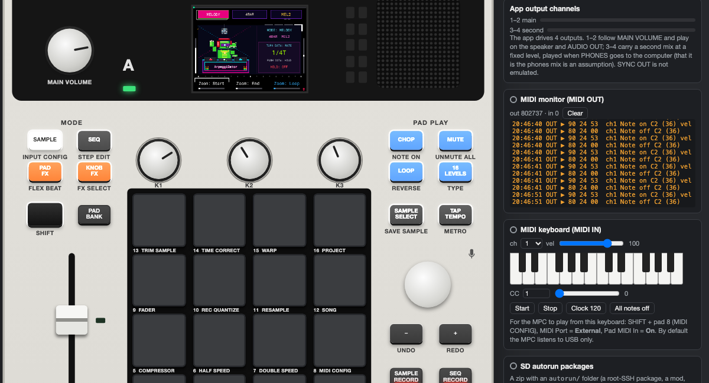
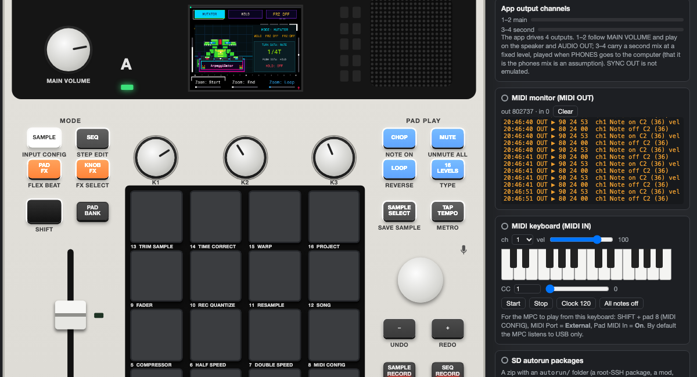
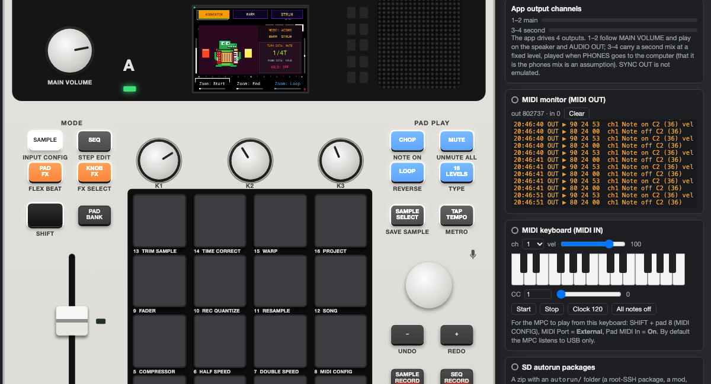
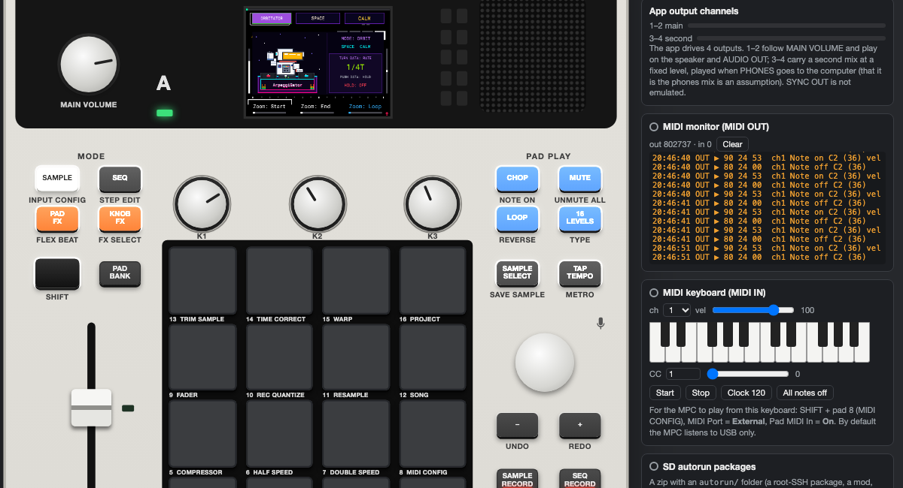

# ArpeggiGator — User Manual / GUI v0.0.7.3
**Version described:** `0.0.7.3` (released; Repaint fix after STOP on the native audio engine)
**UI baseline:** tag `v0.0.6.0`, commit `b912eed1028c9b9c54a166b36433cd349e782be0`
**Build used for screenshots:** `34a9ec26949b98c7a3ec83562aea94af9ba7d9f35771687db0d3e929841a5b7b`
**Sources:** code at tag `v0.0.6.0`, the `v0.0.7.3` release (native audio engine, first-pad fix, caption fixes and STOP repaint fix).
**Purpose:** a user manual. AI test procedures remain in internal QA documentation only and are not part of this public version.

---

> ### ⚠️ Compatibility — read before you insert the card
>
> **TESTED:** ArpeggiGator **v0.0.7.3** was developed and tested in the virtual MPC Sample emulator (QA/DEV) and confirmed on physical AKAI MPC Sample hardware, on **firmware 1.3.0.12** (guard `44507c7a7d3029c411b2e3780ea286ca3e08b7e3ffd7b5047d52f73bf5299d1f`). The 0.0.7.x package ships a `native-audio` build targeted at firmware 1.3.0.12 with hook-signature verification. Emulator audio (`MPC_MOD_FEATURES=emulator-audio`) was used only in experimental phases; the release build uses native audio and is firmware-guarded.
>
> **NOT TESTED:** **Physical MPC Sample hardware** — no hardware confirmation exists; the author tests in the emulator only. **No other firmware version**, **no other MPC model**, and **no other operating system or environment** has been tested. Compatibility outside the tested emulator + firmware 1.3.0.12 combination is **unknown and unverified**.
>
> **BEFORE YOU INSERT THE CARD:** make a complete backup of your **entire original SD card** and **all your projects** to a computer. Verify the backup, then install. If the card already has an `autorun/` folder, back it up and remove it first — do not merge.
>
> This is **BETA software**, unofficial and provided **"AS IS"**, entirely at your own risk.

## 1. What ArpeggiGator is

A mod for **Akai MPC Sample 1.3.0.12** firmware. It adds five music engines visible on the device screen in **Sample + 16 Levels** mode. It does not change the native screen during everyday use — Sample and 16 Levels look normal until you hold SHIFT or enable an engine.

> ArpeggiGator is not affiliated with, endorsed by or supported by AKAI Professional.

A heavily simplified model:

```
MPC Sample (firmware)
└── SAMPLE screen
    └── 16 LEVELS
        └── [SHIFT held OR engine enabled] → ArpeggiGator overlay
            ├── left: animation (a different "gator" for each mode)
            ├── top right: MODE + parameters + RATE + HOLD
            └── bottom: B1 / B2 / B3 captions (only while SHIFT is held)
```

---

## 2. Option tree — keyboard shortcuts

All of the following work **only in 16 Levels** (exceptions: STOP and PLAY).

| Button | Without SHIFT | With SHIFT |
|---|---|---|
| **B1** (SCREEN 1) | — | **Change mode**: Off → ARP → MELODY → MUTATOR → ACCORDATOR → ORBITATOR → Off |
| **B2** (SCREEN 2) | — | **Parameter 1** — depends on the mode (see the table below) |
| **B3** (SCREEN 3) | — | **Parameter 2** — depends on the mode |
| **DATA** (knob) | turn = **RATE**, press = **HOLD on/off** | no action |
| **16 LEVELS** | enter/exit the view (only on the Sample screen) | does not exit the view |
| **PAD 1…16** | feeds notes into the engine | firmware shortcut, not a note |
| **STOP** | single press = native behaviour; **double press within ≤650 ms** = full ArpeggiGator reset | — |
| **PLAY** | the mod only reads the firmware transport state; it has no PLAY handler of its own | — |

**Key rule for input:** send SHIFT and B\* as **separate** events (press/release), never in a single packet — otherwise the firmware may lose the SHIFT state and the step becomes invalid. Take the screenshot **while holding**, not after release.

---

## 3. B2 / B3 parameter table for each mode

| Mode | B2 — parameter 1 | B3 — parameter 2 |
|---|---|---|
| **ARP** | Pattern: `UP → DOWN → UP/DOWN → DOWN/UP → CONVERGE → DIVERGE → RANDOM → PLAYED` | Additional octaves: `+0 → +1 → +2 → +3` (copies of the lowest pad) |
| **MELODY** | Phrase length: `2BAR → 4BAR → 8BAR → 16BAR` (32/64/128/256 steps) | Preset phrase: `MEL1 … MEL9` |
| **MUTATOR** | Mutation intensity: `SUBTLE → WILD → CHAOS` | **Freeze**: `FRZ OFF ⇄ FRZ ON` |
| **ACCORDATOR** | Chord mood: `WARM → SAD → SPACE → CINEMA` | Style: `STRUM → PULSE → WAVE` |
| **ORBITATOR** | Atmosphere: `AMBIENT → SPACE → DARK → RHYTHM` | Dynamics: `CALM → FLOW → WILD` (wandering radius of 7/14/24 semitones) |

The right panel shows exactly: `MODE: ARP | MELODY | MUTATOR | ACCORD | ORBIT` plus the parameter line and `RATE`. In v0.0.6.0 MUTATOR, `FRZ` appeared **twice** (in the B3 caption and in the panel) — a known, test-confirmed quirk; the 0.0.7.2 label change simplifies it to `SUBTLE FRZ:OFF`.

---

## 4. Modes — description and screenshots

Screenshots from DEV, build `34a9ec26…`, size `1200x950`. The `_plain` file is the view without SHIFT; `_shift` is the moment of holding SHIFT (the B1–B3 captions are visible).

### 4.1 ARP — green "gator" over the pattern background
`MODE: ARP`, pattern and `+N`. Accumulates the pressed pads and plays them back in the selected order. HOLD toggles individual pad bits (XOR).




### 4.2 MELODY — club, pink stage
`MODE: MELODY`, `2BAR…16BAR`, `MEL1…MEL9`. Ready-made melodic phrases; a new pad "steals" the voice (monophonic).




### 4.3 MUTATOR — lab, cyan
`MODE: MUTATOR`, intensity and `FRZ ON/OFF`. Mutates the buffer once per full pass of the phrase. **Freeze** stops further mutation — subsequent loops play identically. The freeze state is shown in the B3 caption and in the mod panel.




### 4.4 ACCORDATOR — warm chord scene, amber
`MODE: ACCORD`, mood and style. Chord intervals depend on the mood; `STRUM/PULSE/WAVE` changes the articulation.




### 4.5 ORBITATOR — cosmos, violet
`MODE: ORBIT`, atmosphere and dynamics. The melody wanders across the scale; `CALM/FLOW/WILD` is the wandering radius.




---

## 5. Operation — step-by-step procedures

### 5.1 Enabling the mod
1. Go to the **Sample** screen.
2. Press **16 LEVELS**.
3. Hold **SHIFT** — the softkey captions and the overlay appear.
4. **SHIFT + B1** → choose a mode. **SHIFT + B2/B3** → parameters.

### 5.2 HOLD and notes
- Press **DATA** (HOLD: ON).
- In melodic/generative modes, tap a pad — it becomes a latch (green). A new pad takes over the voice.
- In ARP, HOLD XORs the bits: tapping the same pad turns it off.
- Pressing DATA again clears the latches and turns HOLD off.

### 5.3 Freeze (MUTATOR only)
Set MUTATOR mode, hold SHIFT and press B3 (`FRZ ON`). The sequence stops mutating. Press SHIFT+B3 again → `FRZ OFF`.

### 5.4 Swapping samples during playback (test-confirmed)
1. Set MELODY, enable HOLD and the sequence.
2. Leave 16 Levels for the **Sample** screen. Music **does not stop** (`BACKGROUND_PLAYBACK_ACTIVE`).
3. Tap pads on the sample screen — you change **one sample for the whole sequence** (for all notes).
4. Return to 16 Levels — the sequence keeps playing with the new sample.

The discs are unchanged: a voice already sounding is not retuned; the change applies to subsequent notes.

### 5.5 STOP
- Single STOP = native behaviour.
- **Double STOP within 650 ms** = full reset: Off, clear the engines, HOLD, the active sample and the LED indicators.

---

## 6. Download

Version **0.0.7.3** — one codebase, two delivery profiles. Both artifacts are published under the
[v0.0.7.3](https://github.com/OSCILLUNE/ArpeggiGator/releases/tag/v0.0.7.3) tag.

| Artifact | Purpose | SHA-256 |
|---|---|---|
| [`arpeggigator-v0.0.7.3.zip`](https://github.com/OSCILLUNE/ArpeggiGator/releases/download/v0.0.7.3/arpeggigator-v0.0.7.3.zip) | SD card → physical MPC Sample 1.3.0.12. After unpacking, copy the `autorun/` folder to the card. [Direct download](https://github.com/OSCILLUNE/ArpeggiGator/releases/download/v0.0.7.3/arpeggigator-v0.0.7.3.zip). | `1d1a884cfbe8afaf92e47b64567a4d0f7de5110a99c20319ec42a617ddaf4369` |
| [`arpeggigator-v0.0.7.3-lab.so`](https://github.com/OSCILLUNE/ArpeggiGator/releases/download/v0.0.7.3/arpeggigator-v0.0.7.3-lab.so) | Emulator / QA-DEV: `python3 lab.py preload …`. **This is not an SD-card package.** [Direct download](https://github.com/OSCILLUNE/ArpeggiGator/releases/download/v0.0.7.3/arpeggigator-v0.0.7.3-lab.so). | `4799d4a0279ee47269ca7a45ec9497a891b611953104c75023179e5b0da6b3e7` |

Verify the package before inserting the card. The expected SHA-256 is the value in the table above:

```
shasum -a 256 arpeggigator-v0.0.7.3.zip
```

---

UI description and screenshots come from v0.0.6.0 (labels updated in 0.0.7.2). Screenshots: DEV, build `34a9ec26…`, 18 Nov 2026.

## Contact

Questions, bug reports or feedback: **ArpeggiGator@proton.me**
